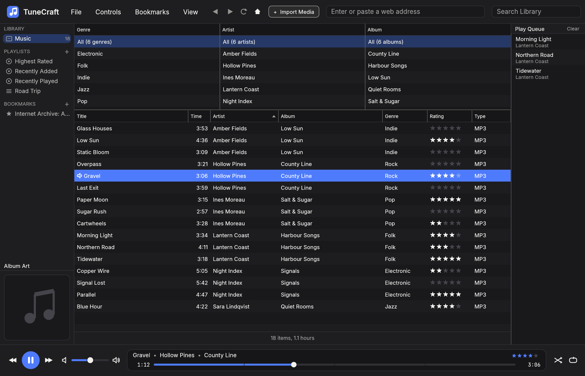

<p align="center">
  
</p>

<h1 align="center">TuneCraft</h1>

<p align="center">
  A music player with a built-in web browser, written from scratch in Rust for current macOS.<br>
  
</p>

<p align="center">
  
</p>

TuneCraft brings back what people liked about the Songbird media player (2005–2013), which
no longer runs on macOS (it was a 32-bit app), with a look that matches the Craft apps
(ArtCraft, PhotoCraft, VectorCraft).

## What it does

- **Library**: import folders (or drop files on the window); title, artist, album, genre,
  year, track and disc numbers and album art are read from the files' tags. Genre / Artist /
  Album filter lists, search, sortable columns, 0–5 star ratings, play counts.
- **Playlists**: playlists you build by hand (drag tracks onto them), smart playlists with
  rules (Highest Rated, Recently Added and Recently Played come built in), M3U/PLS import,
  M3U export.
- **Playback**: MP3, AAC/M4A, ALAC, FLAC, WAV, AIFF, Ogg Vorbis, MKA and CAF; shuffle,
  repeat off / all / one, a play queue (Play Next, Add to Play Queue), hold Back/Forward to
  skip 15 s, click the total time for time remaining, volume with mute.
- **Web browser**: tabs, back/forward/reload/home, address bar with paste-and-go, web search,
  bookmarks. Every page is scanned for links to audio files; they're listed in a resizable
  *Web Playlist* under the page, where they can be played directly or downloaded into the
  library.
- **Craft look**: follows the Mac's light or dark mode (View ▸ Appearance), Inter and
  JetBrains Mono, the Craft blue.

## Build and run

Requires Rust (stable, edition 2024) on macOS 11 or later.

```sh
cargo run --release
```

Make an app bundle (unsigned; ad-hoc signed for local use) in `dist/TuneCraft.app`:

```sh
sh packaging/macos/bundle.sh
```

`cargo test` runs the unit tests (shuffle order, repeat, queue, time formats, file decoding,
address parsing). Two network/device tests are ignored by default
(`cargo test -- --ignored`).

`--screenshot <file.png>` starts with sample data, draws, saves a picture of the window and
quits (used for checks); `--open-url <url>` opens a web page in a tab at start.

## Where things are

| Path | What |
|---|---|
| `src/main.rs` | start-up, window, command-line options |
| `src/app.rs` | app state, playback flow, menus, keyboard, browser events |
| `src/panes.rs` | drawing: side panel, track list, web playlist, player bar, dialogs |
| `src/library.rs` | tracks, playlists, smart rules, saving, folder scanning |
| `src/player.rs` | audio output and the play-order rules |
| `src/web.rs` | browser tabs (system WebKit view), page scanning, downloads |
| `src/theme.rs` | colours, fonts, drawn icons |
| `MECHANICS.md` | every behaviour rule and where it came from |

Your library is saved in `~/Library/Application Support/TuneCraft/library.json`; downloads go
to `~/Music/TuneCraft Downloads`.

## Relationship to Songbird

TuneCraft is a new program. Songbird 2.2 (© POTI, Inc., GPL) was studied from the installed
app to learn how it behaved (column layout, smart-playlist rules, shuffle and repeat, web
playlist scanning); those findings are written down with their sources in `MECHANICS.md`.
No Songbird code, artwork, logos or text were copied, and the Songbird name is not used for
the product.

## Licence

Licensed under either of [Apache License, Version 2.0](LICENSE-APACHE) or
[MIT license](LICENSE-MIT) at your option. Third-party material is listed in
[ATTRIBUTION.md](ATTRIBUTION.md).
